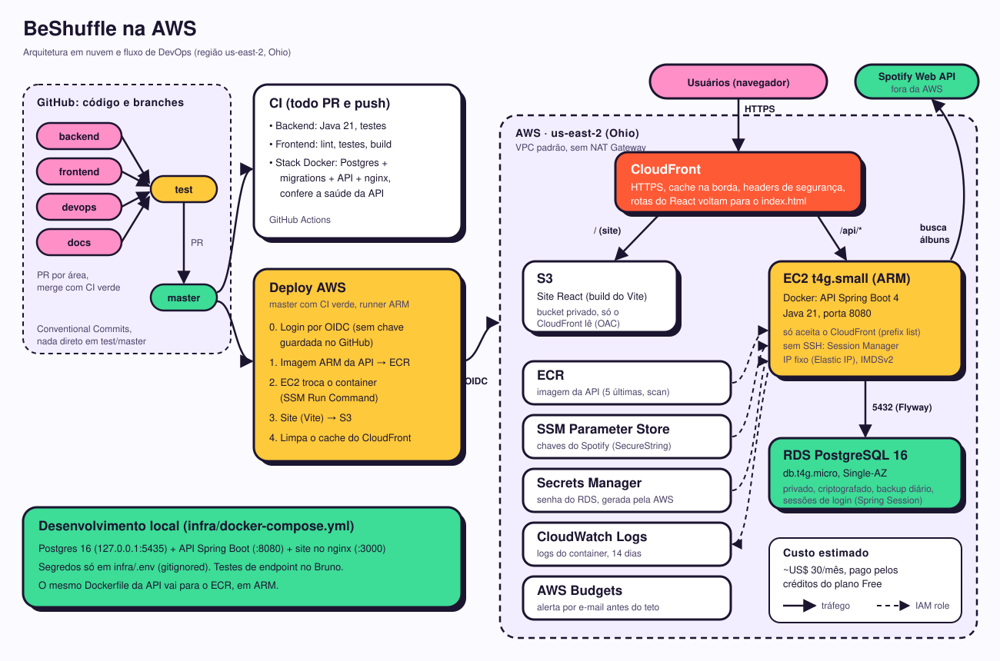

# BeShuffle

Uma jukebox que sorteia álbuns do Spotify. Todo dia há um **Álbum do Dia**, igual para todo mundo. Quem quiser
descobrir mais música sorteia outros discos, e quem cria conta escolhe estilos, vê o que a comunidade tirou no dia
e dá nota ao Álbum do Dia. Tudo é grátis.



## O que dá para fazer

| Recurso | Visitante | Conta grátis |
| --- | --- | --- |
| Ouvir o Álbum do Dia (sorteio à parte, vira à meia-noite de São Paulo) | Sim | Sim |
| Sortear um álbum aleatório | 1 por dia | 10 por dia |
| Escolher estilos no sorteio (um ou vários) | Não | Sim |
| Ver os sorteados do dia por toda a comunidade | Não | Sim |
| Dar nota (1 a 5) e comentar | Não | Só o Álbum do Dia |
| Página de perfil com os seus sorteios e a sua nota | Não | Sim |

### Como o sorteio evita álbuns que ninguém ouviria

O app do Spotify em Development Mode não recebe popularidade nem gêneros. Por isso o sorteio usa a própria ordem da
busca, que vem por relevância:

- **Sorteio geral:** sorteia um ano entre 1960 e hoje e uma página entre os 50 primeiros resultados daquele ano no
  mercado BR.
- **Filtro:** descarta singles, EPs, coletâneas, "Various Artists", discos com menos de 6 ou mais de 40 faixas e
  nomes com termos como "ninar", "karaokê", "tributo" ou "greatest hits".
- **Estilos internacionais** (rock, jazz, metal, pop, indie e outros): busca faixas `genre:"..."` e sorteia o álbum
  de uma delas.
- **Estilos brasileiros e hip hop:** funk, sertanejo, pagode, piseiro, rap nacional e hip hop quase não têm resultado
  na busca por gênero. Esses estilos sorteiam um artista de uma lista nossa, testada contra a API, e um álbum dele.

### Regras que a API garante

- **Fichas contadas no servidor.** O visitante é identificado por um cookie HttpOnly aleatório, sem dado pessoal.
  Cada rede (IP) tem um teto de 20 sorteios de visitante por dia, para quem apaga cookies não sortear sem limite.
  O IP só é guardado como hash com sal, nunca em texto.
- **Gasto atômico.** A ficha é gasta num `UPDATE` condicional, então dois cliques ao mesmo tempo não passam do
  limite. Se o Spotify falhar, a ficha volta.
- **Login em cookie de sessão** guardado no Postgres (Spring Session JDBC): um deploy não desloga ninguém.
- **CSRF no modo SPA:** todo `POST` e `PUT` manda o header `X-XSRF-TOKEN` com o valor do cookie `XSRF-TOKEN`.

## Stack

| Parte | Tecnologia |
| --- | --- |
| API | Java 21, Spring Boot 4, Spring Security 7, Spring Data JPA, Spring Session JDBC, Flyway |
| Banco | PostgreSQL 16 (H2 nos testes) |
| Site | React 19, TypeScript, Vite 6, React Router 7, CSS Modules, Vitest e Testing Library |
| Local | Docker Compose: Postgres, API e site no nginx |
| Nuvem | AWS: CloudFront, S3, EC2 Graviton, RDS, ECR, SSM, Secrets Manager, CloudWatch, Budgets |
| Infraestrutura em código | Terraform (`infra/terraform`) |
| CI/CD | GitHub Actions: testes, stack Docker de verdade e deploy na AWS por OIDC |
| Testes de endpoint | Bruno (coleção local, fora do repositório) |

## Arquitetura na AWS

- **CloudFront** é a única porta de entrada, com HTTPS. Ele serve o site e repassa `/api/*` para a API, sem cache.
- **S3** guarda o build do site num bucket privado, que só o CloudFront lê (Origin Access Control).
- **EC2 `t4g.small`** (ARM, Amazon Linux 2023) roda a API em Docker:
  - a porta 8080 só aceita o CloudFront;
  - não há SSH: o acesso é pelo Session Manager;
  - o IP é fixo (Elastic IP), e os créditos de CPU ficam no modo `standard`, sem cobrança surpresa.
- **RDS PostgreSQL** `db.t4g.micro` é privado (só a API acessa), criptografado e tem backup diário. A senha é gerada
  pela AWS e fica no Secrets Manager.
- **Segredos:** as chaves do Spotify ficam no SSM Parameter Store. Nada de segredo vai para o código, para o estado do
  Terraform ou para o GitHub.
- **Deploy:** o GitHub Actions assume uma role por OIDC (sem chave guardada) só a partir da `master`. Ele publica a
  imagem ARM no ECR, atualiza o container pelo SSM, publica o site no S3 e limpa o cache do CloudFront.
- **Custo:** cerca de US$ 30/mês, pagos pelos créditos do plano Free da AWS. Há um orçamento com alerta por e-mail.

Passo a passo para criar e atualizar a infraestrutura: [infra/README.md](infra/README.md#aws).

## Rodar localmente

1. **Crie o arquivo de segredos.** Chaves e senhas ficam só nesse arquivo, que o git ignora:

   ```bash
   cp infra/.env.example infra/.env
   ```

   Preencha `DB_PASSWORD`, `SPOTIFY_CLIENT_ID` e `SPOTIFY_CLIENT_SECRET`. As credenciais do Spotify saem do
   [dashboard de desenvolvedor](https://developer.spotify.com/dashboard).

2. **Suba tudo com Docker:**

   ```bash
   cd infra
   docker compose up --build -d
   ```

   O site abre em http://localhost:3000 e a API responde em http://localhost:8080.

Para desenvolver uma parte só, siga o README da pasta correspondente.

### Requisitos

- Docker com Docker Compose
- JDK 21 para rodar o backend fora do Docker (o JDK 27 não compila o Lombok do Spring Boot 4.0.3)
- Node.js 22 para rodar o frontend fora do Docker
- Para a AWS: AWS CLI logado e Terraform 1.9+ (ou a imagem Docker `hashicorp/terraform`)

## Testes

| Onde | Comando | O que cobre |
| --- | --- | --- |
| Backend | `cd backend && ./mvnw clean verify` | Serviços, Spotify (mockado), integração com segurança, CSRF, sessão no banco |
| Frontend | `cd frontend && npm run lint && npm test && npm run build` | Páginas e fluxos com a API mockada |
| Stack | CI, job "Stack Docker" | Postgres, migrations, API e nginx juntos, conferindo a saúde da API |
| Endpoints | Coleção do Bruno (ambientes `local` e `docker-site`) | Fluxos reais: contas, sorteios, estilos, notas |

## Endpoints da API

| Método | Rota | O que faz |
| --- | --- | --- |
| `GET` | `/api/albums/daily` | Álbum do Dia |
| `POST` | `/api/draws` | Sorteia gastando uma ficha; conta logada pode mandar `{"genres":[...]}` |
| `GET` | `/api/draws/allowance` | Fichas de hoje |
| `GET` | `/api/draws/today` | Sorteados de hoje pela comunidade (login) |
| `GET` | `/api/draws/mine` | Os seus sorteios de hoje (login) |
| `GET` | `/api/genres` | Estilos do sorteio |
| `GET`, `PUT` | `/api/reviews/today` | Notas do Álbum do Dia; o `PUT` cria ou edita a sua (login) |
| `POST` | `/api/auth/register`, `/api/auth/login`, `/api/auth/logout` | Conta e sessão |
| `GET` | `/api/me` | Quem está logado |
| `GET` | `/actuator/health` | Saúde da API |

Detalhes e códigos de erro: [backend/README.md](backend/README.md#endpoints).

## Estrutura

| Pasta | O que tem | Documentação |
| --- | --- | --- |
| `backend/` | API Spring Boot | [backend/README.md](backend/README.md) |
| `frontend/` | Site em React | [frontend/README.md](frontend/README.md) |
| `infra/` | Docker Compose, Dockerfiles, nginx, Terraform da AWS e scripts de deploy | [infra/README.md](infra/README.md) |
| `.github/workflows/` | CI (`ci.yml`) e deploy na AWS (`deploy.yml`) | [infra/README.md](infra/README.md#ci) |
| `docs/` | Contexto, roadmap, diagrama da arquitetura e proposta visual | [docs/CONTEXTO.md](docs/CONTEXTO.md) |

## Fluxo de branches

```
backend ─┐
frontend ┼─► PR ─► test ─► (CI verde + testes) ─► PR ─► master ─► deploy na AWS
devops ──┤
docs ────┘
```

- **Branch por área:** `backend`, `frontend`, `devops` (infra e CI) e `docs`.
- **Tudo passa pela `test`:** cada mudança entra na `test` por pull request.
- **`master` só depois dos testes:** o PR `test → master` só abre com o CI verde e a `test` testada. Cada merge na
  `master` com CI verde dispara o deploy.
- **Commits:** [Conventional Commits](https://www.conventionalcommits.org/pt-br/), por exemplo `feat(frontend): ...`,
  `fix(backend): ...`, `ci: ...` ou `docs: ...`.
