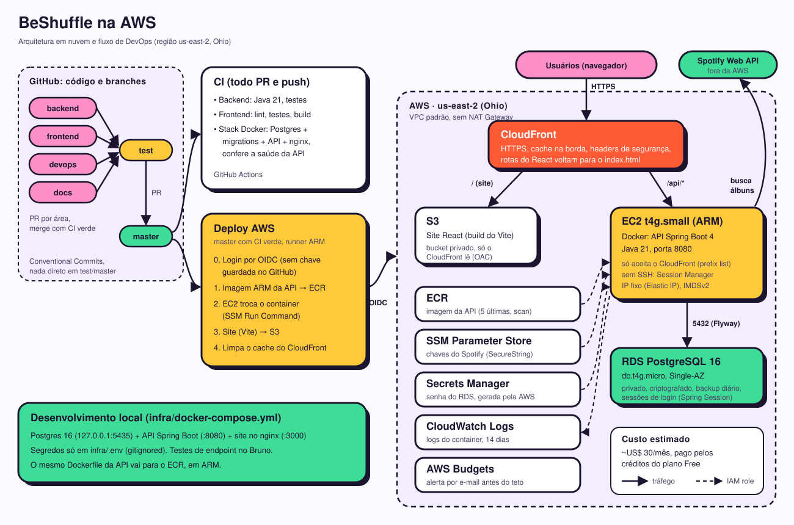

# Infra e DevOps

Tudo o que sobe, empacota e verifica o BeShuffle fica aqui. A exceção é o workflow de CI: o GitHub só o
lê em `.github/workflows/ci.yml`, na raiz do repositório.

| Arquivo | Papel |
| --- | --- |
| `docker-compose.yml` | Sobe o Postgres, a API e o site |
| `.env.example` | Modelo do `.env`, o único lugar com chaves e senhas (o `.env` é ignorado pelo git) |
| `docker/backend.Dockerfile` | Imagem da API. Contexto: `backend/` |
| `docker/frontend.Dockerfile` | Imagem do site (build do Vite servido pelo nginx). Contexto: a raiz do repositório |
| `docker/nginx.conf.template` | nginx do site: arquivos estáticos e repasse de `/api` para a API |
| `docker/*.dockerignore` | O que cada build deixa de fora |
| `terraform/` | Infraestrutura da AWS: CloudFront, S3, EC2, RDS, ECR, IAM, logs e orçamento |
| `aws/put-secrets.sh` | Copia as chaves do Spotify do `.env` para o SSM Parameter Store |
| `aws/deploy-manual.sh` | Primeiro deploy (ou deploy sem GitHub Actions): imagem, site, API e cache |

## Subir tudo

```bash
cp .env.example .env   # preencha DB_PASSWORD e as chaves do Spotify
docker compose up --build -d
```

| Serviço | Endereço |
| --- | --- |
| Site | http://localhost:3000 (`FRONTEND_PORT`) |
| API | http://localhost:8080 (`SERVER_PORT`) |
| Postgres | `127.0.0.1:5435` (só esta máquina acessa) |

Sem `DB_PASSWORD`, `SPOTIFY_CLIENT_ID` ou `SPOTIFY_CLIENT_SECRET` no `.env`, o compose para com uma mensagem
dizendo qual variável falta.

Para desenvolver só uma parte, suba só o banco (`docker compose up -d db`) e rode a API e o site fora do Docker
(veja `backend/README.md` e `frontend/README.md`).

## Login

A API guarda a sessão num cookie HttpOnly (`JSESSIONID`), e o nginx do site repassa esse cookie junto com
`/api`, então nada muda no proxy. Em produção, com HTTPS, use `COOKIE_SECURE=true` no `.env`; em localhost
deixe `false`, ou o navegador não envia o cookie. `SESSION_TIMEOUT` (padrão `7d`) é quanto tempo o login dura.

A sessão fica no Postgres (Spring Session JDBC): reiniciar a API ou fazer deploy não desloga ninguém.

Os sorteios do dia são contados no banco. O visitante é identificado pelo cookie `bs_anon` (HttpOnly, 1 ano), que
também segue o `COOKIE_SECURE`; o nginx repassa os cookies sem configuração extra.

## CI

O workflow `ci.yml` roda a cada PR e a cada push em `master` e `test`:

1. **Backend:** `./mvnw clean verify` com Java 21.
2. **Frontend:** `npm ci`, lint, testes e build com Node 22.
3. **Stack Docker:** sobe Postgres, API e site com o compose (senha aleatória e chaves falsas do Spotify) e confere
   `/actuator/health`, `/api/draws/allowance` pelo nginx e uma rota do React. Pega migration quebrada, API que não
   sobe e proxy errado. Só roda se os dois jobs anteriores passarem.

O workflow `deploy.yml` faz o deploy na AWS depois que o CI passa na `master` (ver abaixo).

## AWS



| Peça | Configuração | Por quê |
| --- | --- | --- |
| CloudFront | HTTPS, `/api/*` sem cache para o EC2, o resto do S3, função que manda rotas do React para o `index.html` | Porta única, HTTPS grátis, site perto do usuário |
| S3 | Bucket privado, lido só pelo CloudFront (OAC) | Site estático sem servidor |
| EC2 | `t4g.small` ARM, Amazon Linux 2023, Docker, IP fixo, IMDSv2, CPU `standard`, sem SSH | A API Java precisa de ~1 GB; Graviton é o mais barato |
| RDS | PostgreSQL 16 `db.t4g.micro`, privado, criptografado, backup de 1 dia, proteção contra exclusão | Banco gerenciado, elegível ao plano Free |
| ECR | Imagem da API, guarda as 5 últimas, scan de vulnerabilidades | Registro privado perto do EC2 |
| SSM e Secrets Manager | Chaves do Spotify (SecureString) e senha do RDS (gerada pela AWS) | Segredos fora do código, do estado do Terraform e do GitHub |
| CloudWatch Logs | Logs do container, 14 dias | Ver erros sem entrar no servidor |
| IAM | Role do EC2 com o mínimo; role de deploy por OIDC só para a `master` | Nenhuma chave de acesso guardada |
| Budgets | Alerta em 80% do gasto real e 100% do previsto | Não estourar os créditos |

Não há NAT Gateway nem VPC nova: tudo usa a VPC padrão. O banco não tem IP público e o EC2 só aceita o CloudFront.

### Criar a infraestrutura (uma vez)

Pré-requisitos: AWS CLI logado (`aws login`) e Terraform 1.9+. Sem Terraform instalado, use a imagem Docker
`hashicorp/terraform` com as credenciais de `aws configure export-credentials --format env`.

```bash
cd infra/terraform
cp terraform.tfvars.example terraform.tfvars   # e-mail do orçamento
terraform init
terraform plan -out plano.tfplan
terraform apply plano.tfplan
```

Depois:

1. **Segredos do Spotify no SSM:** `infra/aws/put-secrets.sh us-east-1` (lê o `infra/.env`).
2. **Primeiro deploy:** `infra/aws/deploy-manual.sh`. Ele monta a imagem ARM, sobe o site e liga a API. O endereço
   aparece no fim (`terraform output site_url`).
3. **Deploy automático:** crie as variáveis do repositório no GitHub com os valores do `terraform output`:
   `AWS_REGION`, `AWS_DEPLOY_ROLE_ARN`, `ECR_REPOSITORY`, `SITE_BUCKET`, `CLOUDFRONT_DISTRIBUTION_ID` e
   `EC2_INSTANCE_ID`. A partir daí, cada merge na `master` com CI verde faz o deploy.

O estado do Terraform fica local (`terraform.tfstate`, ignorado pelo git) e não tem segredos.

### Operar

- **Logs:** CloudWatch, grupo `/beshuffle/api`.
- **Entrar no servidor:** `aws ssm start-session --target <instance_id>` (não há SSH).
- **Reiniciar a API com a última imagem:** pelo Session Manager, `sudo /opt/beshuffle/deploy.sh latest`.
- **Apagar tudo:** mude `db_deletion_protection = false`, rode `terraform apply` e depois `terraform destroy`. O
  RDS deixa um snapshot final (`beshuffle-db-final`), que pode ser apagado à mão.
